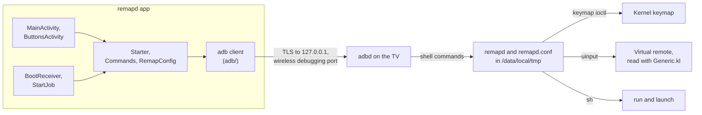

# Handoff notes

What someone taking over remapd needs to know: how the pieces fit together, how to build, test and release it, what was decided and why, and what's still open. The [README](README.md) covers using remapd; this file is about maintaining it.

*Last updated 1 November 2026, after the first release (v2.1).*

**Contents:** [At a glance](#at-a-glance) · [How the pieces fit](#how-the-pieces-fit) · [Repository map](#repository-map) · [remapd](#remapd-the-daemon) · [The app](#the-app) · [Building and testing](#building-and-testing) · [CI](#ci) · [Releasing](#releasing) · [History](#history-and-decisions) · [Gotchas](#gotchas) · [Open items](#open-items) · [Conventions](#conventions)

## At a glance

| | |
| --- | --- |
| **What** | Makes every button on a Bluetooth TV remote work on Android TV and Google TV, without root. Two parts: **remapd**, a small C program that runs as the ADB shell user, and the **remapd app**, which sets up buttons and starts remapd again after every restart. |
| **Status** | First release out: [v2.1](https://github.com/gureetk/remapd/releases/tag/v2.1), published 1 November 2026 from `a339274`. The app is `ca.gureet.remapd` 2.1 (versionCode 3), with remapd 1.3 inside. |
| **Tested on** | One setup: a Chromecast with Google TV (4K) and an ACE666BT remote (`0508:0110`). Needs Android 11 or newer, for wireless debugging. |
| **Repository** | [gureetk/remapd](https://github.com/gureetk/remapd): public, MIT license, default branch `main`. |
| **Release key** | Alias `remapd`, SHA-256 fingerprint `E3:CA:25:30:F9:3A:91:B0:9C:27:88:9D:52:41:3D:5E:B5:E4:82:34:C4:51:4A:45:C2:BC:D7:42:25:76:FD:7F`. The owner keeps it, and so does GitHub's `release` environment. It's never in the repository. |

## How the pieces fit



- The app never talks to remapd directly. It signs in to adbd on the TV itself with its own key, like a computer would, and runs shell commands as the ADB shell user, the user that's allowed to change keymaps and create input devices. Every command is in [`Commands.java`](app/src/main/java/ca/gureet/remapd/Commands.java), and the app reads their output by `@@` marker lines.
- Once started (`remapd start`), remapd runs on its own until the TV restarts or USB debugging is turned off. After a restart the app starts it again.

## Repository map

| Path | What's there |
| --- | --- |
| `daemon/remapd.c` | remapd: one C file with no dependencies, built static for ARM. |
| `daemon/keynames.h`, `daemon/androidkeys.h` | Generated tables of Linux and Android key names (see `tools/`). |
| `daemon/build.sh` | Builds remapd with zig for 32- and 64-bit ARM, and copies it into the app as `libremapd.so`. |
| `daemon/examples/ace666bt.conf` | The config for the ACE666BT. The tests use it too. |
| `daemon/test/` | End-to-end tests on a Linux PC: `run_tests.py`, the `fakeioctl.c` shim, and AOSP's `Generic.kl`. |
| `app/src/main/java/ca/gureet/remapd/` | The app (see [The app](#the-app)). |
| `app/src/main/java/ca/gureet/remapd/adb/` | The app's own adb client. |
| `app/src/test/` | JUnit tests: the shell commands (`CommandsTest`), config editing (`RemapConfigTest`), and adb keys and packets. |
| `app/adbtest/` | Tests the adb client against a fake adbd, written in Python with OpenSSL. |
| `tools/` | `gen_keynames.py` and `gen_androidkeys.py` regenerate the key tables; `make_icons.py` draws the icon, the TV banner and the README header. |
| `.github/workflows/` | `build.yml` (every push and pull request) and `release.yml` (version tags). |
| `CHANGELOG.md` | One section per release. The release workflow turns it into the release notes. |
| `docs/images/` | The README header image. |

## remapd (the daemon)

- **Commands** are listed in the [README](README.md#commands). The app uses `start`, `stop`, `status`, `check` (to validate a config before saving it) and `learn`.
- **Files on the TV**, all in `/data/local/tmp`: `remapd`, `remapd.conf`, `remapd.conf.bak` (the app's previous version), `remapd.log` (emptied once it passes 256 KiB) and `remapd.pid`.
- **`map`** sets the kernel's keymap entry for a HID usage (`EVIOCSKEYCODE_V2`). **`send`** switches the button's own key off and presses the Android key on a uinput device named "remapd virtual remote", which Android reads with `Generic.kl`. Keys that `Generic.kl` doesn't have go through `input keyevent` instead. **`run`** runs a command with `/system/bin/sh`. **`launch`** finds the app's TV (or ordinary) launcher activity and starts it with `am start`.
- remapd watches `/dev/input` with inotify and rescans it every 2 seconds too, so it notices a remote reconnecting and applies the config again. It puts the original keymap back when it stops.
- `check` and `run` find the key layout file Android uses for each remote (from `dumpsys input`, or by trying the paths Android would), and point out global keys and accessibility services that can swallow presses.
- **`learn`** grabs the input devices (`EVIOCGRAB`) so the press doesn't reach Android, and warns about any it can't grab. It waits for one press and prints one line for the app to parse:
  `learned <usage|none> <Linux key> <vendor:product> <Android key|UNKNOWN|?> <owner|-> <device name>`. It prints `timeout` (exit status 3) if nothing was pressed, and lets go of the devices when whoever started it goes away.
- Limits: 64 buttons, 8 `device` lines, 32 input devices.
- **Version**: `VERSION` in `remapd.c` (now `1.3`), printed on the first line of the usage text. The app turns it into a number (1.3 is 1003) and only replaces an older remapd on the TV. **Raise it whenever remapd changes**, or the app keeps the old copy.

## The app

- Plain Android SDK with no libraries (JUnit is only for the tests). Java 11 source, `minSdk 30` (Android 11), `compileSdk` and `targetSdk 34`, Android Gradle Plugin 8.7.3, Gradle 8.10.2, built with JDK 17.
- remapd rides along in the APK as `lib/<abi>/libremapd.so`. `useLegacyPackaging` makes Android unpack it to a folder the shell user can read. `Commands.install` copies it to `/data/local/tmp` only when there's no remapd there yet, or an older one.

| Class | What it does |
| --- | --- |
| `MainActivity` | The main screen: Set up, the way to the Buttons screen, start or restart remapd, stop it, check its status, and the end of its log. |
| `ButtonsActivity` | The Buttons screen: listens for a press (15 seconds), lets you pick what the button does, and saves. One adb connection stays open while the screen is in use, and closes after 10 minutes without use. |
| `Starter` | Runs everything over adb: the one-time setup, starting remapd, and the Buttons screen's connection. Switches wireless debugging on before each use and off after. |
| `Commands` | Every shell command the app runs, and the parsers for their output. Plain Java, unit tested. |
| `RemapConfig` | Edits `remapd.conf` the way a person would: each button's rule stays where it was, comments and unknown lines are kept, and a rule's label is its line's `# comment`. Plain Java, unit tested. |
| `KeyNames` | Friendly key names, and the keys a remote usually wants. |
| `WirelessDebugging` | The `adb_wifi_enabled` setting, plus notes so it isn't left on if the app is stopped halfway. |
| `PortFinder` | Finds the wireless debugging port over mDNS (`_adb-tls-connect._tcp`), counting only services on the TV's own addresses. |
| `AppKey` | The app's adb key, stored encrypted (`adbkey.enc`) with an AES key that stays in Android's keystore (`remapd-adb-key-wrap`). |
| `BootReceiver`, `StartJob` | After a restart, start remapd once there's a network (up to 6 tries). Also the jobs that switch wireless debugging off if the app was stopped halfway, or once the TV's network question gets answered late. |
| `adb/AdbConnection` | Does what `adb connect` and `adb shell` do, and nothing else. Plain TCP with RSA token signing (for setup), or TLS with the key in a certificate (for wireless debugging). |
| `adb/AdbIdentity`, `adb/SelfSignedCertificate`, `adb/AdbMessage` | The RSA key in adb's formats, the certificate TLS needs to carry it, and adb's 24-byte packets. |

**One-time setup.** The user runs `adb tcpip 5555` from a computer. The app connects to `127.0.0.1:5555` and offers its key, so the TV asks "Allow USB debugging?". "Always allow" puts the key in `/data/misc/adb/adb_keys`, which wireless debugging checks too, so no pairing code is needed. Over that connection the app runs `Commands.setup`:

```sh
pm grant ca.gureet.remapd android.permission.WRITE_SECURE_SETTINGS
settings put global adb_allowed_connection_time 0     # adb's 7-day key timeout off
cmd deviceidle whitelist +ca.gureet.remapd
appops set ca.gureet.remapd AUTO_REVOKE_PERMISSIONS_IF_UNUSED ignore
```

Then it closes port 5555 with adb's `usb:` service and checks it's closed. That restarts adbd, which stops remapd if it was running. So the app then installs remapd and, if there's already a config, starts it over wireless debugging, the way it will after a restart. Last, it switches wireless debugging off.

**After a restart.** `BootReceiver` schedules `StartJob`, which waits for a network, switches wireless debugging on, finds its port, and signs in over TLS. It then runs `Commands.ensure`, which updates remapd if the app's copy is newer and starts it unless it's running. Then it switches wireless debugging off.

**Saving buttons.** The app writes the new config to `remapd.conf.new` and checks it with `remapd check`. If remapd accepts it, the app keeps the old file as `remapd.conf.bak`, moves the new one into place and restarts remapd.

## Building and testing

The [README](README.md#building-and-testing) explains each command. In short, from the repository root:

```sh
pip install ziglang==0.17.0           # or install zig itself
sh daemon/build.sh                    # remapd, and its copy inside the app
./gradlew :app:testReleaseUnitTest :app:assembleRelease
TEST_SH=mksh ./gradlew :app:testReleaseUnitTest --tests '*CommandsTest*' --rerun
python3 daemon/test/run_tests.py      # needs gcc and Python 3, no device
pip install pyopenssl cryptography adb-shell
CONSCRYPT_JAR=/path/to/conscrypt-openjdk-uber-2.5.2.jar python3 app/adbtest/run_tests.py
```

- Build remapd before the app. The APK carries whatever is in `app/src/main/jniLibs`, which git ignores.
- Without `keystore.properties`, release builds are signed with the debug key. CI builds its test APKs that way, so each one has a different throwaway key.
- The daemon tests run remapd on the PC with `LD_PRELOAD=fakeioctl.so`. FIFOs stand in for the remote's input nodes and a plain file for `/dev/uinput`, and `REMAPD_TEST_ROOT` points remapd's Android paths at a sandbox folder. The fake writes its keymap files whole and renames them into place, and the tests poll (`wait_for`) rather than sleep. Both were changes after a flaky CI run.
- Android's shell is mksh, so `CommandsTest` runs the real shell snippets with `sh` and, in CI, with mksh too.
- CI pins what it downloads: ziglang 0.17.0, pyopenssl 26.4.0, cryptography 50.0.1, adb-shell 0.4.4, and Conscrypt 2.5.2 checked against its SHA-256.

## CI

**`build.yml`** runs on every push and pull request:

- `daemon`: runs the tests and the ARM build, then uploads the `remapd` artifact (both binaries and the example config).
- `app`: builds remapd, runs the unit tests and builds the APK, runs `CommandsTest` under mksh, tests the adb client with the JDK and then with Conscrypt, then uploads the `remapd-app` artifact.

**`release.yml`** runs on `v*` tags, in two jobs:

1. **`build`**, with no secrets. It checks that the tag is `v` plus `versionName`, and that `CHANGELOG.md` has a section for that version. It runs remapd's tests and the app's unit tests, builds everything and uploads `release-files`.
2. **`publish`** runs in the `release` environment, so it waits for approval. It downloads the files; download-artifact checks them against the digest recorded at upload. It signs the APK with `apksigner` from the newest stable build-tools on the runner (v2 and v3 signatures, no v1), and checks that the signing certificate is the one in `RELEASE_CERT_SHA256` and no other. Then it publishes the release: `remapd-<version>.apk`, `remapd-<remapd version>-arm`, `remapd-<remapd version>-arm64` and `SHA256SUMS`, with the changelog section as the notes. A version with a `-` in it becomes a pre-release. The job runs none of the repository's code.

As of PR #5, the actions are checkout v7, setup-python v7, setup-java v6, setup-gradle v6, upload-artifact v7 and download-artifact v8. In `release.yml`, the artifact actions are pinned to commits, since they hand the files to the job that holds the key. setup-gradle uses `cache-provider: basic`: since v6 its default cache is a closed-source add-on under Gradle's terms of use, and the project didn't take that on.

## Releasing

Follow [Making a release](README.md#making-a-release) in the README. Afterwards, check what was published:

```sh
gh release download v<version> -R gureetk/remapd
sha256sum -c SHA256SUMS
apksigner verify --print-certs remapd-<version>.apk
# certificate SHA-256 digest: e3ca2530f93a91b09c27889d52413d5eb5e48234c4514a45c2bcd7422576fd7f
```

The `release` environment (Settings → Environments) has:

- **Required reviewers**, so every release run waits for approval.
- **Deployment branches and tags**: a `v*` rule of type **Tag**. Saved as a branch rule, it blocks release runs.
- Two secrets, `RELEASE_KEYSTORE_BASE64` and `RELEASE_KEYSTORE_PASSWORD`, and one variable (not a secret), `RELEASE_CERT_SHA256`.

The keystore is PKCS12, with the alias `remapd`. Its key has the same password as the store, because the workflow passes only one password. The owner keeps a backup of the keystore and its password outside GitHub. Without them, no release can update an installed app. And anyone who had them could make an update that gets the app's adb access.

**If a release run fails before it publishes,** fix the problem on `main`, then move the tag to the fixed commit. Re-running the old run won't pick up the fix, because a run uses the workflow file from the tagged commit:

```sh
git fetch origin
git push origin :refs/tags/v<version>
git tag -f -a v<version> -m "remapd <version>" <fixed commit>
git push origin v<version>
```

Once a release is published, leave its tag alone and make a new version instead.

## History and decisions

- **Why remapd exists.** The ACE666BT reports itself as `0508:0110`. The Chromecast already has a key layout file for that ID, made for another remote, and it turns the colour buttons and Play/Pause into `UNKNOWN`. The kernel also reports HID usages it doesn't know as `KEY_UNKNOWN`, so remapping apps (Key Mapper was looked at first) see all of those buttons as one button. Changing the kernel's keymap per HID usage fixes the first problem without root, from the ADB shell user.
- **`send` and the virtual remote.** Changing the keymap isn't enough when the remote's key layout file lacks the key. So remapd presses the key on its own uinput device, which Android reads with the standard `Generic.kl`.
- **Shizuku, then a built-in adb client.** At first (30 October 2026) the app started remapd through Shizuku. PR #1 replaced that with the app's own adb client, because the owner wanted the app to handle wireless debugging itself, with no other app needed. The client signs in with a key allowed once over `adb tcpip`, instead of using wireless debugging's pairing codes. Shizuku's adb code was a reference; see Credits in the README.
- **PR #2** added the Buttons screen. `remapd learn` holds on to the input devices, so a press during setup doesn't act on the TV. The app became 2.1 (versionCode 3), with remapd 1.3.
- **PR #3** added signed releases from version tags. The signing key is one the owner made and keeps, rather than one generated in CI or kept in the repository. The same PR renamed the app from `io.github.remapd` to `ca.gureet.remapd` (the owner's domain is gureet.ca) before the first release, since changing the application ID later would break updates. It also fixed the flaky daemon test.
- **PR #4** fixed the release workflow's check of the signing certificate. Newer apksigner prints `V3.0 Signer: certificate SHA-256 digest: …`, where older ones print `Signer #1 certificate SHA-256 digest: …`.
- **v2.1**, the first release, was published on 1 November 2026.
- **PR #5** moved the workflows to current action versions (Node 24) and kept setup-gradle's open-source cache.

## Gotchas

- Raise `VERSION` in `remapd.c` with every change to remapd, or the app keeps the older copy on the TV.
- The app's shell commands run under mksh (`/system/bin/sh`), so test them with `TEST_SH=mksh`. An apostrophe inside a single-quoted command has to be written `'\''`.
- Test builds and releases are signed with different keys. Switching between them means running `adb uninstall ca.gureet.remapd` and doing the setup again; `remapd.conf` stays on the TV.
- Closing port 5555 (`adb usb`, or the app's `usb:`) restarts adbd, and that stops remapd.
- Wireless debugging only works on Wi-Fi, and Android asks once per access point whether to allow it. A mesh or dual-band router has several access points.
- Setup turns off adb's 7-day authorization timeout for every allowed key (`adb_allowed_connection_time 0`). Signing in over wireless debugging doesn't count as using a key, so without that the TV would forget the app's key after 7 days.
- apksigner's output changes between build-tools versions, so anything that reads it must accept both forms.
- In the `release` environment, the `v*` rule must be a tag rule, and the certificate fingerprint is a variable, not a secret.
- Changing a workflow and re-running a failed release run doesn't work. Move the tag instead (see [Releasing](#releasing)).

## Open items

- **Gradle 8.10.2** is flagged as out of date by setup-gradle. Updating it may mean updating the Android Gradle Plugin (8.7.3) as well.
- **GitHub's `ubuntu-latest` moves to Ubuntu 26.04** between 19 October and 19 November 2026, and the workflows don't pin a version. The daemon tests' C code compiles as C23, GCC 15's default; nothing else has been tried on 26.04 yet.
- **A screenshot of the app** for the README is still wanted (`docs/images/`).
- **Merged branches** (`builtin-adb`, `button-editor`, `releases`, `fix-release-verify`, `update-actions`) can be deleted. Turning on "Automatically delete head branches" in the repository settings would handle this from now on.
- **Only one TV and one remote** have been tried. Reports from other setups would help, especially other remotes' button codes and other TVs' key layout files.
- **Dependabot for GitHub Actions** could raise updates like PR #5 automatically.

## Conventions

- Every change goes through a pull request with green CI, and is merged with a merge commit.
- Commits made with Claude are authored as `Claude <noreply@anthropic.com>` and end with these lines:

  ```
  Co-Authored-By: gureet <noreply@git.gureet.ca>
  Co-Authored-By: Claude Opus 5.5 <noreply@anthropic.com>
  ```

  Commits and pull requests don't link to chat sessions.
- Never commit `keystore.properties`, `*.jks`, `*.keystore`, `local.properties` or `app/src/main/jniLibs`. `.gitignore` covers all of them.
- CI pins what it downloads: tool versions, and the release workflow's artifact actions by commit.
- User-facing text (the README, the app's strings and remapd's messages) is plain and short.
