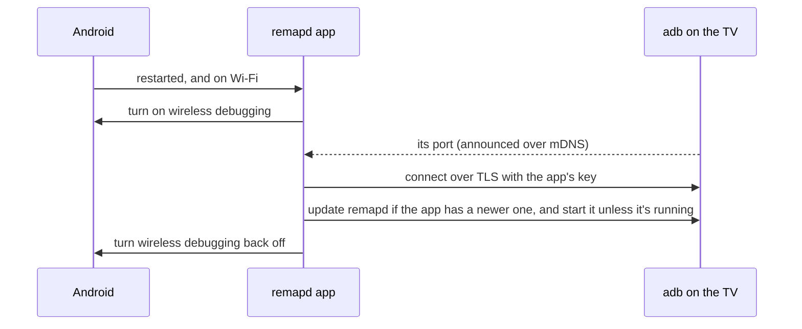

<p align="center">
  
</p>

<p align="center">
  Make every button on a Bluetooth TV remote work on Android TV and Google TV. No root needed.
</p>

<p align="center">
  <a href="https://github.com/gureetk/remapd/releases/latest"></a>
  <a href="https://github.com/gureetk/remapd/actions/workflows/build.yml"></a>
  <a href="LICENSE"></a>
  
</p>

Cheap Bluetooth remotes come with colour buttons, channel keys, Guide, Info, app shortcuts and more, and on Android TV many of them do nothing. remapd fixes that from an ADB shell: it gives each button the key it's meant to send, presses keys Android would otherwise ignore, and can open apps or run commands. Its companion app sets up each button when you press it on the remote, and keeps remapd running after a restart.

It was built for a **Chromecast with Google TV (4K)** and an **ACE666BT** remote, and works the same way for any Bluetooth remote that Android sees as a keyboard.

**Contents:** [Why buttons do nothing](#why-some-buttons-do-nothing) · [How it works](#how-remapd-works) · [Setup](#setup) · [After a restart](#after-a-restart) · [Without the app](#without-the-app) · [Config](#config-reference) · [Commands](#commands) · [Limitations](#limitations) · [Building](#building-and-testing)

## Why some buttons do nothing

A button press goes through two translations before an app sees it, and either one can lose it:


1. **The kernel doesn't know the button.** Every HID usage code the kernel doesn't recognise becomes `KEY_UNKNOWN`, so Android, and every remapping app, sees all of those buttons as the same button.
2. **The key layout file doesn't know the key.** Android turns kernel keys into Android keys with a `.kl` file that it picks by the remote's vendor and product ID. Cheap remotes often reuse an ID the device already has its own file for, and that file may only cover the basics.

Both happened with the ACE666BT. Here's what an earlier version of remapd printed on the Chromecast. The remote reports itself as `0508:0110`, and the Chromecast's file for that ID turns the colour buttons and even Play/Pause into `UNKNOWN`:

```
event6: "ACE666BT Keyboard" (0508:0110) has 7 of the 7 configured buttons
event6: Android turns its keys into Android keys with /vendor/usr/keylayout/Vendor_0508_Product_0110.kl
000c0069 pressed: KEY_RED = Android UNKNOWN (apps ignore it)
000c006a pressed: KEY_GREEN = Android UNKNOWN (apps ignore it)
000c00cd pressed: KEY_PLAYPAUSE = Android UNKNOWN (apps ignore it)
000c00ea pressed: KEY_VOLUMEDOWN = Android VOLUME_DOWN
```

With root you could edit the key layout file. remapd works around both problems without it.

## How remapd works

remapd is a small program you start over ADB. It runs as the ADB shell user, which is allowed to change the kernel's keymap for a button and to create virtual input devices.


- **`send`** switches the button's own key off and presses an Android key on a *virtual remote* instead. Android reads the virtual remote with its standard key layout (`Generic.kl`), which knows all the TV and media keys. Holding the button holds the key. A key with no line in `Generic.kl`, like `INFO`, is sent with the slower `input keyevent` instead.
- **`map`** changes the kernel's keymap so a button reports a different Linux key. That's enough when Android reads the remote with its standard key layout.
- **`run`** and **`launch`** run a shell command or open an app.

remapd re-applies everything when the remote reconnects, and puts the buttons back when it stops. `check` and `run` show which Android key each button becomes, flag keys the system keeps for itself, and list accessibility services (other remapping apps) that can swallow presses.

## Setup

You need a computer with [platform-tools](https://developer.android.com/tools/releases/platform-tools) (`adb`) once, to let the app in. After that the app does the rest. It needs Android 11 or newer, and the TV on Wi-Fi.

### 1. Turn on ADB

On the TV, go to Settings → System → About and select "Android TV OS build" seven times to unlock Developer options. Then turn on **USB debugging** and **Wireless debugging** under Settings → System → Developer options, and connect from your computer:

```sh
adb pair <ip>:<pairing port>     # from "Pair device with pairing code" on the TV
adb connect <ip>:<port>          # the address on the Wireless debugging screen
```

### 2. Install the app and let it in

Download `remapd-<version>.apk` from the [latest release](https://github.com/gureetk/remapd/releases/latest), then:

```sh
adb install remapd-2.1.apk
adb tcpip 5555
```

Open **remapd** on the TV and select **Set up**. When the TV asks "Allow USB debugging?", tick **Always allow from this computer** and select **Allow**. The fingerprint in the prompt is also shown in the app. The app then:

- gives itself permission to switch wireless debugging on and off (`WRITE_SECURE_SETTINGS`);
- turns off adb's 7-day authorization timeout, like the "Disable adb authorization timeout" developer option. Otherwise the TV would forget the app's key 7 days after setup, since signing in over wireless debugging doesn't count as using it. The setting is for every key the TV has allowed, your computer's too;
- exempts itself from battery restrictions and from being paused when unused, so Android doesn't hold it back after a restart;
- checks the TV saved its key ("Always allow"), closes port 5555 again (like `adb usb`) and checks it's closed;
- puts remapd, which comes inside the app, in `/data/local/tmp`. If there's a `remapd.conf` already (you've set up buttons before), it starts remapd the same way it will after a restart;
- turns wireless debugging off. The app switches it on by itself when it needs it; turn it on again in Developer options when you want to use adb from your computer.

The app shows what each step did, and says so if one didn't work.

### 3. Set up your buttons

Select **Buttons**, then **Add a button**, and press the button on your remote. While the app listens, remapd holds on to the TV's input devices, so the press doesn't do anything on the TV (if it can't hold on to one, the app says so). The app shows the button's code, which remote it's on and what Android makes of it, and you choose what it does:

- **Send an Android key**: the colour keys, media and channel keys, Guide, Info and others, or any key Android has;
- **Open an app** installed on the TV;
- **Do nothing**: switch the button off;
- **Run a shell command**, as the ADB shell user.

Select a button in the list to change, rename or remove it. Each change goes into `/data/local/tmp/remapd.conf` (the previous version is kept as `remapd.conf.bak`), and remapd restarts with it.

- The first button you set up adds a `device` line for its remote, so remapd leaves your other remotes alone. A button on another remote asks before adding that one too, since every button in the file then works on it as well.
- The app asks before changing a button you get around the TV with (the arrows, OK, Back and Home).
- It's the same file you'd [write by hand](#config-reference). The app leaves the lines it doesn't change as they are, comments included; it only drops Windows line endings, a byte-order mark and blank lines at the end. A button with both a `map` line and a `run` or `launch` line keeps its `map` line when you pick another command or app.

Wireless debugging stays on while the Buttons screen is open. It goes off when you leave the screen, or after about 10 minutes without using it.

### 4. Updating

A newer release installs over the old one (`adb install -r remapd-<version>.apk`) and keeps the setup and your buttons. Every release is signed with the same key, whose SHA-256 fingerprint is:

```
E3:CA:25:30:F9:3A:91:B0:9C:27:88:9D:52:41:3D:5E:B5:E4:82:34:C4:51:4A:45:C2:BC:D7:42:25:76:FD:7F
```

`apksigner verify --print-certs remapd-<version>.apk` (from the Android SDK's build-tools) shows the fingerprint of a download, in lowercase without the colons: `e3ca2530f93a91b09c27889d52413d5eb5e48234c4514a45c2bcd7422576fd7f`. The test builds from GitHub Actions' other runs are each signed with a different throwaway key. Moving between those and a release means uninstalling the app first (`adb uninstall ca.gureet.remapd`) and doing the setup again; `remapd.conf` stays on the TV.

## After a restart

Anything started over ADB stops when the device restarts. The app starts remapd again by itself, through wireless debugging on the TV, with no root and no other apps needed.



remapd keeps running after that: adb only stops when USB debugging is off too. It all takes a few seconds. If remapd didn't start after the last restart, opening the app tries again. The app also shows whether remapd is running, starts, stops and checks it, and shows the end of its log.

Wireless debugging is only on for those few seconds, and while the Buttons screen is open. If the app is stopped halfway, a job switches it off a few minutes later. Android only allows wireless debugging on Wi-Fi access points someone has allowed it on, and asks otherwise ("Allow wireless debugging on this network?"); a dual-band or mesh router has several access points. If nobody answers in time, the app waits for the answer and finishes the job once it's allowed.

### How the app signs in to adb

The app has its own adb key, like `~/.android/adbkey` on a computer. During setup it connects to the TV's own port 5555 and sends the key, which makes the TV show the usual "Allow USB debugging?" prompt. "Always allow" saves the key in `/data/misc/adb/adb_keys`, the list a paired computer goes into too, and adb checks that list for wireless debugging connections as well. So the app doesn't need wireless debugging's pairing codes.

- The key stays on the TV: it's in the app's private storage, encrypted with a key kept in Android's keystore.
- The app only connects to the TV itself (127.0.0.1), runs only the setup steps above and remapd's own commands (installing it, starting, stopping, checking, learning buttons, and reading and saving `remapd.conf`), and offers nothing to other apps.
- To take its access away, revoke USB debugging authorizations in Developer options (that also removes your computer's), or uninstall the app. Uninstalling deletes the app's key; the TV's list keeps the public half until you revoke authorizations, but that's useless without the private half. The authorization timeout stays off until you turn "Disable adb authorization timeout" off again.
- The adb client is small and written for this app ([`app/src/main/java/ca/gureet/remapd/adb`](app/src/main/java/ca/gureet/remapd/adb)). It's tested against a fake adbd that does TLS with OpenSSL ([`app/adbtest`](app/adbtest)).

## Without the app

remapd works on its own from `adb shell`; it just won't start again by itself after a restart.

1. **Find your buttons' codes.** Run `adb shell getevent -l` and press each button. The `MSC_SCAN` value (for example `000c0069`) is its code:

   ```
   /dev/input/event6: EV_MSC       MSC_SCAN             000c0069
   /dev/input/event6: EV_KEY       KEY_RED              DOWN
   ```

2. **Write a config.** Start from [`daemon/examples/ace666bt.conf`](daemon/examples/ace666bt.conf). A few lines from it:

   ```ini
   device ACE666BT

   send   000c0069 PROG_RED            # colour buttons
   send   000c00cd MEDIA_PLAY_PAUSE
   send   000c004b CHANNEL_UP          # Pg/Ch Up
   launch 000c0008 org.jellyfin.androidtv
   run    000c0004 am start -a android.settings.SETTINGS
   map    000c0221 KEY_UNKNOWN         # turn the Assistant button off
   ```

3. **Copy remapd over and try it.** Download `remapd-<version>-arm` from the [latest release](https://github.com/gureetk/remapd/releases/latest), or [build it yourself](#building-and-testing). This 32-bit ARM build runs on 32- and 64-bit ARM devices.

   ```sh
   adb push remapd-1.3-arm /data/local/tmp/remapd
   adb push remapd.conf /data/local/tmp/
   adb shell chmod 755 /data/local/tmp/remapd
   adb shell /data/local/tmp/remapd check /data/local/tmp/remapd.conf
   adb shell -t /data/local/tmp/remapd run /data/local/tmp/remapd.conf
   ```

   `run` shows each press and what Android gets. Ctrl+C stops it and puts the buttons back:

   ```
   000c0069 pressed -> Android PROG_RED
   000c004b pressed -> Android CHANNEL_UP
   000c0060 pressed -> Android INFO (with input keyevent)
   000c0058 pressed -> launch com.google.android.youtube.tv
   ```

4. **Keep it running** with `adb shell /data/local/tmp/remapd start /data/local/tmp/remapd.conf`. remapd keeps running in the background after you disconnect ADB, while the TV is in standby, and when the remote reconnects. It stops when the device restarts, or when USB debugging or Developer options are turned off. `remapd status` checks it, `remapd stop` stops it, and it logs to `/data/local/tmp/remapd.log`.

## Config reference

One line per button. Codes are the `MSC_SCAN` values from `getevent`, and `#` starts a comment.

| Line | What it does |
| --- | --- |
| `send <code> <ANDROID_KEY>` | Presses an Android key, using the `KeyEvent.KEYCODE_*` name without the prefix (`PROG_RED`, `MEDIA_PLAY_PAUSE`, `CHANNEL_UP`, `GUIDE`, ...). The button's own key is switched off. |
| `map <code> <KEY_NAME>` | Makes the kernel report the button as another Linux key (`KEY_RED`, or `KEY_UNKNOWN` to switch it off). |
| `run <code> <command>` | Runs a shell command as the ADB shell user. |
| `launch <code> <package>` | Opens an app. `adb shell pm list packages -3` lists installed packages. |
| `device <text>` | Only changes devices whose name contains the text, or whose `vendor:product` matches (see `remapd list`). |

## Commands

| Command | |
| --- | --- |
| `remapd list` | List input devices. |
| `remapd check CONF` | Show what CONF would change, and what Android makes of each key, without changing anything. |
| `remapd run CONF` | Apply CONF and show each press (Ctrl+C restores the buttons). |
| `remapd start CONF` | Apply CONF in the background. |
| `remapd stop` | Stop the background copy and restore the buttons. |
| `remapd status` | Is the background copy running? |
| `remapd learn [SECS]` | Wait for one button press (15 seconds by default) and say which button it was, without the press reaching Android. The app's Buttons screen uses it. |

## Limitations

- Buttons that send nothing over Bluetooth (some remotes have IR-only buttons), or that send the same code, can't be told apart.
- Keys the system keeps for itself ("global keys", like `GUIDE` on some devices) never reach apps. `check` and `run` point these out.
- remapd alone doesn't survive a restart. The [app](#after-a-restart) handles that, but only when the TV is on Wi-Fi: Android doesn't allow wireless debugging over Ethernet. The first time the TV uses a Wi-Fi access point, it asks whether to allow wireless debugging there; tick **Always allow**.
- The Buttons screen can only set up buttons that send a code (`MSC_SCAN`); a button that doesn't is reported as such.
- It has been tested on one device and one remote so far. Reports from other setups are welcome.

## Building and testing

| | |
| --- | --- |
| **remapd** | `sh daemon/build.sh` builds static ARM binaries with [zig](https://ziglang.org) (`pip install ziglang` works), with no Android NDK needed, and copies them into the app (`app/src/main/jniLibs`, as `libremapd.so`). Build it before the app: the app installs that copy on the TV, but only over an older remapd (it compares `VERSION` in `remapd.c`), so raise the version when you change remapd. |
| **App** | `./gradlew :app:assembleRelease` (JDK 17+ and the Android SDK). Put `storeFile`, `storePassword`, `keyAlias` and `keyPassword` in `keystore.properties` to sign with your own key; otherwise the debug key is used. |
| **Tests** | `python3 daemon/test/run_tests.py` runs remapd on a Linux PC against a fake remote (gcc and Python 3; no root, no device). `./gradlew :app:testReleaseUnitTest` tests the app's commands (some with a real shell: set `TEST_SH=mksh` to use Android's), config editing and adb key handling. `python3 app/adbtest/run_tests.py` runs the app's adb client against a fake adbd (a JDK, and `pip install pyopenssl cryptography adb-shell`); point `CONSCRYPT_JAR` at Conscrypt's `conscrypt-openjdk-uber` jar to also run it with Android's crypto and TLS provider. |
| **Tools** | `tools/gen_keynames.py` and `tools/gen_androidkeys.py` regenerate the key name tables; `tools/make_icons.py` redraws the icon, TV banner and README header. |

GitHub Actions runs the tests and builds remapd and the app on every push; the binaries are under each run's artifacts.

### Making a release

1. Raise `versionCode` and `versionName` in `app/build.gradle` (and `VERSION` in `daemon/remapd.c` if remapd changed), and add a `## <versionName>` section to [`CHANGELOG.md`](CHANGELOG.md). Its text becomes the release notes.
2. Merge that to `main`, then tag it: `git tag v<versionName> && git push origin v<versionName>`. A tag with a `-` in it, like `v2.2-beta1`, makes a pre-release.
3. The [release workflow](.github/workflows/release.yml) builds and tests everything, then waits for your approval on the run's page. Once you approve, it signs the app and publishes the release with the app, remapd on its own and `SHA256SUMS`.

The signing key lives in the repository's `release` environment (Settings → Environments), which only takes `v*` tags and needs a reviewer's approval. It holds two secrets and one variable:

| Name | Kind | What it holds |
| --- | --- | --- |
| `RELEASE_KEYSTORE_BASE64` | secret | The keystore file (alias `remapd`), in base64 |
| `RELEASE_KEYSTORE_PASSWORD` | secret | Its password |
| `RELEASE_CERT_SHA256` | variable | The key's SHA-256 fingerprint. A release that isn't signed with this key fails. |

Only the job that signs can read them, and it runs none of the repository's code. Keep a backup of the keystore and its password. Without them, a release can't update an installed app; anyone who has them could make an update that gets the app's adb access.

## Credits

- The app's adb client follows the adb protocol as documented and implemented in AOSP ([`protocol.txt`](https://android.googlesource.com/platform/packages/modules/adb/+/refs/heads/main/protocol.txt), adbd's sources), and was checked against [Shizuku](https://github.com/RikkaApps/Shizuku)'s adb code (Apache-2.0), which was a helpful reference.
- `daemon/test/Generic.kl` is Android's standard key layout file from AOSP (Apache-2.0; see its header).
- The key name tables are generated from Linux's `input-event-codes.h` and the Android SDK's `KeyEvent`.

## License

[MIT](LICENSE)
