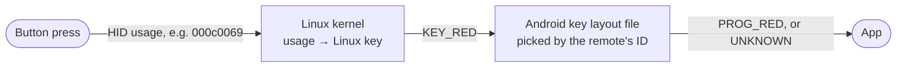
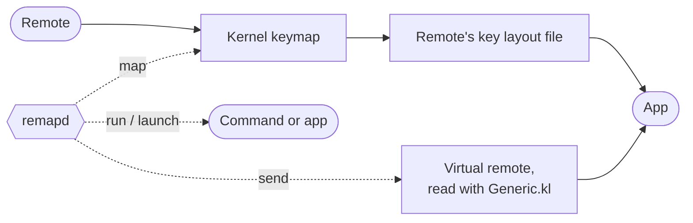

<p align="center">
  
</p>

<p align="center">
  Make every button on a Bluetooth TV remote work on Android TV and Google TV. No root needed.
</p>

<p align="center">
  <a href="https://github.com/gureetk/remapd/actions/workflows/build.yml"></a>
  <a href="LICENSE"></a>
  
</p>

Cheap Bluetooth remotes come with colour buttons, channel keys, Guide, Info, app shortcuts and more, and on Android TV many of them do nothing. remapd fixes that from an ADB shell: it gives each button the key it's meant to send, presses keys Android would otherwise ignore, and can open apps or run commands. A small companion app keeps it running after a restart.

It was built for a **Chromecast with Google TV (4K)** and an **ACE666BT** remote, and works the same way for any Bluetooth remote that Android sees as a keyboard.

**Contents:** [Why buttons do nothing](#why-some-buttons-do-nothing) · [How it works](#how-remapd-works) · [Setup](#setup) · [Start after a restart](#start-it-automatically-after-a-restart) · [Config](#config-reference) · [Commands](#commands) · [Limitations](#limitations) · [Building](#building-and-testing)

## Why some buttons do nothing

A button press goes through two translations before an app sees it, and either one can lose it:



1. **The kernel doesn't know the button.** Every HID usage code the kernel doesn't recognise becomes `KEY_UNKNOWN`, so Android, and every remapping app, sees all of those buttons as the same button.
2. **The key layout file doesn't know the key.** Android turns kernel keys into Android keys with a `.kl` file that it picks by the remote's vendor and product ID. Cheap remotes often reuse an ID the device already has its own file for, and that file may only cover the basics.

Both happened with the ACE666BT. Here's what an earlier version of remapd printed on the Chromecast. The remote reports itself as `0508:0110`, and the Chromecast's file for that ID turns the colour buttons and even Play/Pause into `UNKNOWN`:

```
event6: "ACE666BT Keyboard" (0508:0110) has 7 of the 7 configured buttons
event6: Android turns its keys into Android keys with /vendor/usr/keylayout/Vendor_0508_Product_0110.kl
000c0069 pressed: KEY_RED = Android UNKNOWN (apps ignore it)
000c006a pressed: KEY_GREEN = Android UNKNOWN (apps ignore it)
000c00cd pressed: KEY_PLAYPAUSE = Android UNKNOWN (apps ignore it)
000c00ea pressed: KEY_VOLUMEDOWN = Android VOLUME_DOWN
```

With root you could edit the key layout file. remapd works around both problems without it.

## How remapd works

remapd is a small program you start over ADB. It runs as the ADB shell user, which is allowed to change the kernel's keymap for a button and to create virtual input devices.



- **`send`** switches the button's own key off and presses an Android key on a *virtual remote* instead. Android reads the virtual remote with its standard key layout (`Generic.kl`), which knows all the TV and media keys. Holding the button holds the key. A key with no line in `Generic.kl`, like `INFO`, is sent with the slower `input keyevent` instead.
- **`map`** changes the kernel's keymap so a button reports a different Linux key. That's enough when Android reads the remote with its standard key layout.
- **`run`** and **`launch`** run a shell command or open an app.

remapd re-applies everything when the remote reconnects, and puts the buttons back when it stops. `check` and `run` show which Android key each button becomes, flag keys the system keeps for itself, and list accessibility services (other remapping apps) that can swallow presses.

## Setup

### 1. Turn on ADB and find your buttons' codes

On the TV, go to Settings → System → About and select "Android TV OS build" seven times to unlock Developer options. Then turn on **USB debugging** and **Wireless debugging** under Settings → System → Developer options. On your computer, with [platform-tools](https://developer.android.com/tools/releases/platform-tools):

```sh
adb pair <ip>:<pairing port>     # from "Pair device with pairing code" on the TV
adb connect <ip>:<port>          # the address on the Wireless debugging screen
adb shell getevent -l
```

Press each button. The `MSC_SCAN` value (for example `000c0069`) is its code:

```
/dev/input/event6: EV_MSC       MSC_SCAN             000c0069
/dev/input/event6: EV_KEY       KEY_RED              DOWN
```

### 2. Write a config

Start from [`daemon/examples/ace666bt.conf`](daemon/examples/ace666bt.conf). A few lines from it:

```ini
device ACE666BT

send   000c0069 PROG_RED            # colour buttons
send   000c00cd MEDIA_PLAY_PAUSE
send   000c004b CHANNEL_UP          # Pg/Ch Up
launch 000c0008 org.jellyfin.androidtv
run    000c0004 am start -a android.settings.SETTINGS
map    000c0221 KEY_UNKNOWN         # turn the Assistant button off
```

See the [config reference](#config-reference) for every line type.

### 3. Copy remapd over and try it

Get `remapd` from the latest [build](https://github.com/gureetk/remapd/actions/workflows/build.yml) (the `remapd` artifact), or [build it yourself](#building-and-testing). The 32-bit ARM build runs on 32- and 64-bit ARM devices.

```sh
adb push remapd remapd.conf /data/local/tmp/
adb shell chmod 755 /data/local/tmp/remapd
adb shell /data/local/tmp/remapd check /data/local/tmp/remapd.conf
adb shell -t /data/local/tmp/remapd run /data/local/tmp/remapd.conf
```

`run` shows each press and what Android gets. Ctrl+C stops it and puts the buttons back:

```
000c0069 pressed -> Android PROG_RED
000c004b pressed -> Android CHANNEL_UP
000c0060 pressed -> Android INFO (with input keyevent)
000c0058 pressed -> launch com.google.android.youtube.tv
```

### 4. Keep it running

```sh
adb shell /data/local/tmp/remapd start /data/local/tmp/remapd.conf
```

remapd keeps running in the background after you disconnect ADB, while the TV is in standby, and when the remote reconnects. It stops when the device restarts, or when USB debugging or Developer options are turned off. `remapd status` checks it, `remapd stop` stops it, and it logs to `/data/local/tmp/remapd.log`.

## Start it automatically after a restart

Anything started over ADB stops when the device restarts. The companion app starts remapd again through [Shizuku](https://github.com/RikkaApps/Shizuku), which gives apps the same rights as `adb shell`, using wireless debugging and no root.

1. Install Shizuku. [thedjchi's version](https://github.com/thedjchi/Shizuku) supports Android TV pairing and has **Start on boot**, which starts Shizuku by itself once the TV is on Wi-Fi after a restart. Set it up in Wireless debugging mode and turn that on. Official Shizuku works too, but has to be started by hand after each restart.
2. Install the app (the `remapd-app` artifact from the latest [build](https://github.com/gureetk/remapd/actions/workflows/build.yml)) with `adb install`, open it once and select **Allow access**.

The app starts remapd whenever Shizuku starts, including after a restart, and whenever you open it. It shows whether Shizuku and remapd are running, lets you start and stop remapd, and shows the end of its log.

## Config reference

One line per button. Codes are the `MSC_SCAN` values from `getevent`, and `#` starts a comment.

| Line | What it does |
| --- | --- |
| `send <code> <ANDROID_KEY>` | Presses an Android key, using the `KeyEvent.KEYCODE_*` name without the prefix (`PROG_RED`, `MEDIA_PLAY_PAUSE`, `CHANNEL_UP`, `GUIDE`, ...). The button's own key is switched off. |
| `map <code> <KEY_NAME>` | Makes the kernel report the button as another Linux key (`KEY_RED`, or `KEY_UNKNOWN` to switch it off). |
| `run <code> <command>` | Runs a shell command as the ADB shell user. |
| `launch <code> <package>` | Opens an app. `adb shell pm list packages -3` lists installed packages. |
| `device <text>` | Only changes devices whose name contains the text, or whose `vendor:product` matches (see `remapd list`). |

## Commands

| Command | |
| --- | --- |
| `remapd list` | List input devices. |
| `remapd check CONF` | Show what CONF would change, and what Android makes of each key, without changing anything. |
| `remapd run CONF` | Apply CONF and show each press (Ctrl+C restores the buttons). |
| `remapd start CONF` | Apply CONF in the background. |
| `remapd stop` | Stop the background copy and restore the buttons. |
| `remapd status` | Is the background copy running? |

## Limitations

- Buttons that send nothing over Bluetooth (some remotes have IR-only buttons), or that send the same code, can't be told apart.
- Keys the system keeps for itself ("global keys", like `GUIDE` on some devices) never reach apps. `check` and `run` point these out.
- remapd alone doesn't survive a restart. The [companion app](#start-it-automatically-after-a-restart) handles that.
- It has been tested on one device and one remote so far. Reports from other setups are welcome.

## Building and testing

| | |
| --- | --- |
| **remapd** | `sh daemon/build.sh` builds static ARM binaries with [zig](https://ziglang.org) (`pip install ziglang` works). No Android NDK needed. |
| **App** | `./gradlew :app:assembleRelease` (JDK 17+ and the Android SDK). Put `storeFile`, `storePassword`, `keyAlias` and `keyPassword` in `keystore.properties` to sign with your own key; otherwise the debug key is used. |
| **Tests** | `python3 daemon/test/run_tests.py` runs remapd on a Linux PC against a fake remote (gcc and Python 3; no root, no device). `./gradlew :app:testReleaseUnitTest` tests the app's command handling. |
| **Tools** | `tools/gen_keynames.py` and `tools/gen_androidkeys.py` regenerate the key name tables; `tools/make_icons.py` redraws the icon, TV banner and README header. |

GitHub Actions runs the tests and builds remapd and the app on every push; the binaries are under each run's artifacts.

## Credits

- The app uses the [Shizuku API](https://github.com/RikkaApps/Shizuku-API) (Apache-2.0).
- `daemon/test/Generic.kl` is Android's standard key layout file from AOSP (Apache-2.0; see its header).
- The key name tables are generated from Linux's `input-event-codes.h` and the Android SDK's `KeyEvent`.

## License

[MIT](LICENSE)
